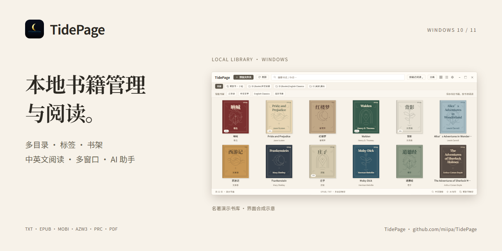
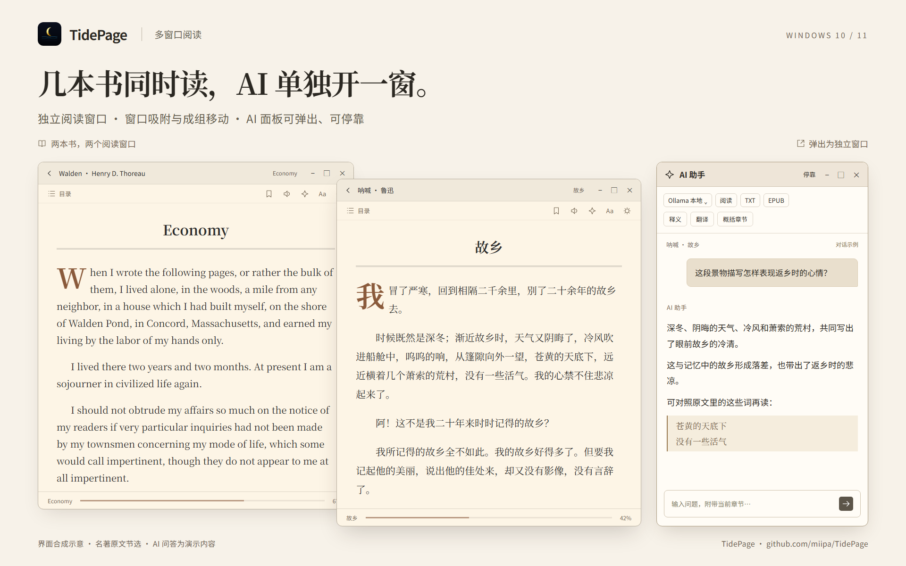
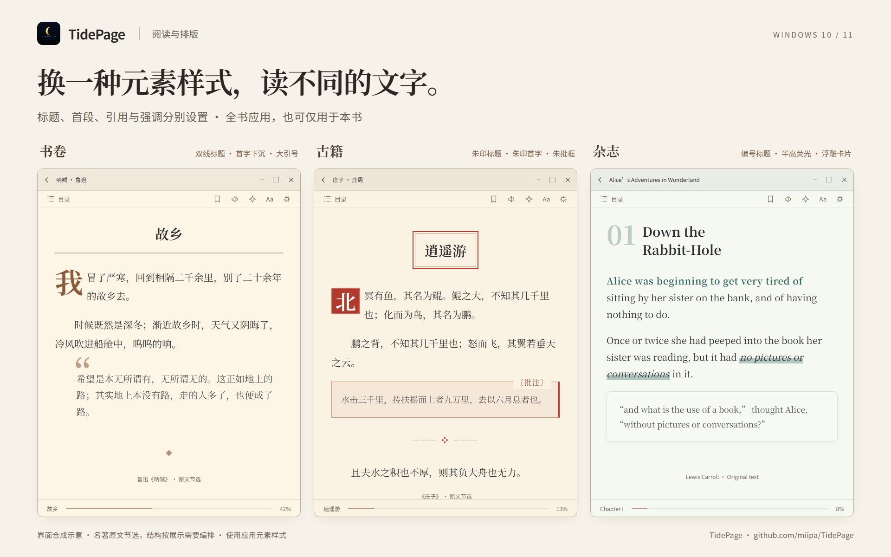
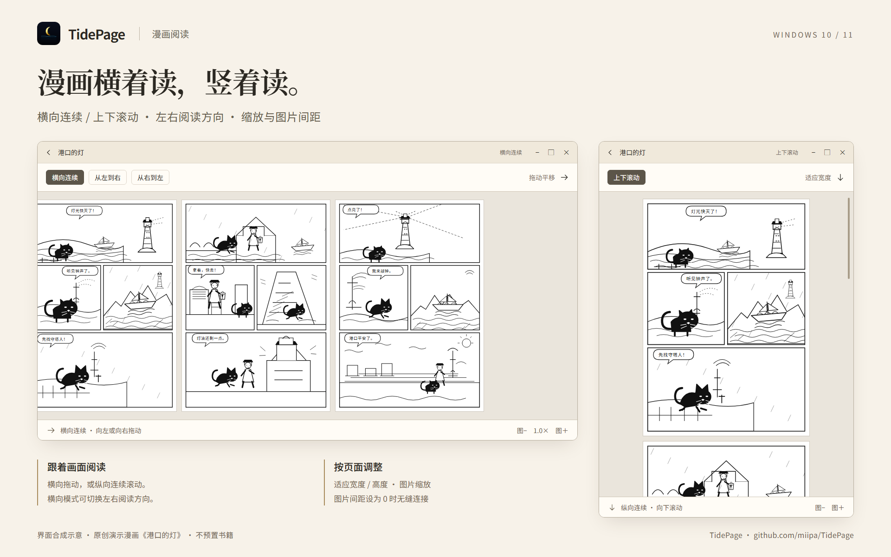

<div align="center">

# TidePage

**Manage and read your local e-book collection**

Windows 10 / 11 · TXT · EPUB · MOBI · AZW3 · PRC · PDF

[Download](https://github.com/miipa/TidePage/releases/latest) · [Local library](#local-library) · [Multiple windows and AI](#multiple-windows-and-ai) · [简体中文](README.md)

</div>

## Local library

TidePage organizes and reads the e-books on your PC. Add local folders to browse books from different locations in one library. Importing leaves the original files in place. Reading progress, bookmarks, highlights, and notes are stored locally.

| Manage books | What you can do |
| --- | --- |
| Multiple folders | Add folders, follow scan progress, and refresh to pick up added or removed files |
| Tags and shelves | Organize books with tags; save selected books or the current filtered results as a shelf |
| Search and sort | Search titles and authors; filter by format, folder, reading status, or tags; use the full-text index to find text and chapters |
| Duplicate books | Review duplicates and their locations, then choose which copies to keep |
| Details and batch actions | Edit titles and authors, reveal files in Explorer, and add tags or remove library entries in batches |

Switch between grid and list views, and sort by last read, date added, title, file time, or file size. Removing a library entry keeps its file; deleting a local file sends it to the Recycle Bin. In book details, Save info changes only the app record. For EPUB files, Save to book can also write the changes to the original file.

## Multiple windows and AI

With multiple windows enabled, the main window stays in the library. Double-click different books to read them in separate windows. Windows can snap together and move as a group, useful for reading an original alongside a translation or reference book.

Keep the AI assistant in the reading sidebar or pop it out into a separate window, then dock it again. Questions can include the current title and a chapter excerpt. Translate or explain selected text and save the result to a highlight note. Local Ollama and online model services are supported and require configuration.



## Reading and typography

Read with vertical scrolling, single-column paging, or two-column paging. Choose from five reading themes, then adjust fonts, font size, line height, paragraph spacing, indentation, alignment, and backgrounds. Individual books can keep their own settings.

Element styles control headings, opening paragraphs, quotes, lists, images, tables, and emphasis. Choose a preset such as Classic, Traditional, Magazine, Journal, or Academic, or adjust individual elements and add custom CSS. The image below uses different passages from Hometown, Zhuangzi, and Alice’s Adventures in Wonderland to show double rules, drop caps, seals, quotation frames, and highlighted emphasis.



## Comic reading

Image-based e-books can use comic mode, with automatic detection or a manual switch. Vertical scrolling arranges pages in a continuous column. Horizontal continuous mode supports drag-to-pan and both left-to-right and right-to-left reading.

Fit images to width or height, or adjust scale and spacing. Set the gap to zero for seamless pages. Hide all images, block individual pages, or restore them later.



## More reading tools

| Feature | Includes |
| --- | --- |
| Bookmarks and notes | Table of contents, in-book search, seven highlight styles, notes grouped by book, and reading statistics |
| Text-to-speech | System or online voices, highlighting that follows speech, chapter continuation, and a sleep timer |
| Format conversion | TXT ⇄ EPUB; MOBI / AZW3 / PRC → TXT or EPUB, saved as new files |
| WebDAV | Reading progress sync, book upload and download, and settings backup and restore |

## Supported formats

| Type | Support |
| --- | --- |
| E-books | TXT, EPUB, MOBI, AZW3, PRC, PDF |
| Text encoding | Automatic detection of UTF-8, UTF-16, GB18030, Big5, and others; manual selection is available |

## Files, data, and network

Original books are read from the local folders you add. Library records, reading data, settings, and caches use the system app-data directory by default. Set `TIDEPAGE_DATA_DIR` to use another location. Cache usage and cleanup are available in Settings.

AI chat, selected-text actions, and AI tagging send relevant book information and text to the configured model service. Ollama requests also go to the configured service address. Online speech connects to the selected voice provider. WebDAV transfers books and reading data through sync actions. TidePage checks GitHub Releases for updates at startup; a manual check is also available in Settings.

## Download and install

1. Visit [GitHub Releases](https://github.com/miipa/TidePage/releases/latest) and download the Windows portable archive for your device architecture.
2. Extract it and run `TidePage.exe`.
3. The WebView2 runtime is required. It is included with Windows 11; on Windows 10, make sure it is installed.

TidePage currently provides Windows 10 / 11 builds. App data uses the system app-data directory by default, so you can replace the program files while keeping your library and reading history.

## Development

Requires [Node.js](https://nodejs.org/) and the [Rust](https://www.rust-lang.org/) toolchain.

```bash
npm install
npm run tauri dev
npm run check
npm run test
npm run check:name
```

Tech stack: Tauri 2, Rust, SvelteKit, Svelte 5, TypeScript, and SQLite.

Images are composite illustrations of current features, with the interface shown in Chinese. The demo library uses Chinese and English classics with original cover designs. Reading samples use original passages from Lu Xun’s Hometown, Zhuangzi, Walden, and Alice’s Adventures in Wonderland, structured for the illustration. Harbor Light is an original comic, and the AI conversation is sample content. These books are not bundled with the app.

## Feedback and support

- Issues and suggestions: [GitHub Issues](https://github.com/miipa/TidePage/issues)
- Project home: <https://github.com/miipa/TidePage>
- QQ group (Chinese): <https://qm.qq.com/q/5bbjW2NIUU>

## License

[MIT](LICENSE)
