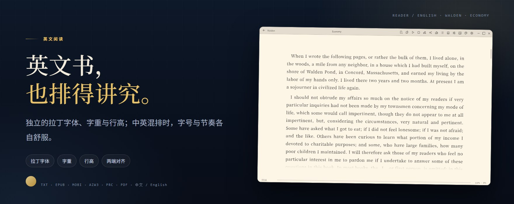
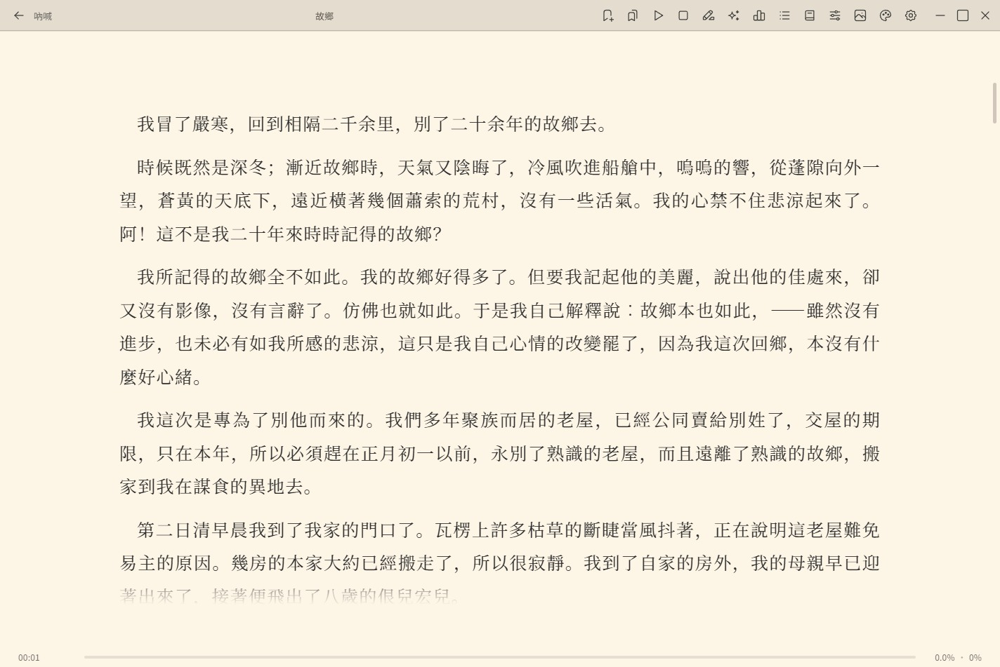
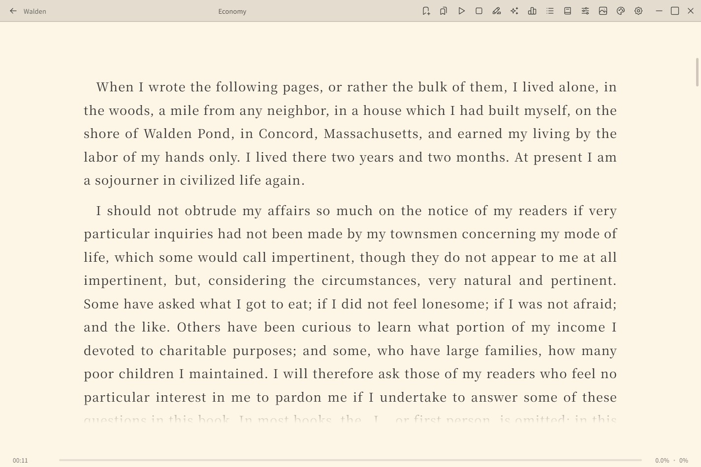

<div align="center">


<br>

**一款把书留在本地的 Windows 桌面阅读器**

TXT · EPUB · MOBI · AZW3 · PRC · PDF　｜　中文排版 · 漫画 · AI · 朗读

[](https://github.com/miipa/TidePage/releases/latest)
[](#系统要求)
[](LICENSE)

[下载](#下载与安装) · [功能](#功能) · [界面](#界面) · [English](README.en.md)

</div>

---

## 写在前面

TidePage 不做在线书城，也不维护云端书架。它只解决一件事：**把电脑里已有的电子书整理好，用舒服的排版读完，并把阅读痕迹留在本机。**

打开应用不需要注册，阅读内容也不会被上传。会主动联网的只有四处：AI 对话、在线朗读、WebDAV 同步，以及启动后自动执行的版本检查。

- **本地优先**：书籍、封面、进度、划线、笔记、统计都保存在本机 SQLite；凭据用 Windows DPAPI 加密。
- **装得下**：虚拟滚动与分级寻址按十万级书库设计；书名 / 作者搜索与筛选都在本地完成。
- **读得久**：中文衬线排版、英文拉丁字体、5 套阅读主题、漫画模式、AI 助手与语音朗读。

## 功能

### 书库

- 同时登记多个本地目录；原文件不移动、不改名（仅在主动编辑书名 / 作者并写回 EPUB 时除外）。
- 虚拟滚动与分级寻址面向十万级书库；网格 / 列表两种视图，搜索与筛选即时生效。
- 支持按最近阅读、加入时间、书名、文件时间、大小排序，并可反向。
- 多选与批量操作、随机开书、拖拽文件入库。
- 每本书可在独立窗口中打开；窗口支持吸附与整组移动。
- 扫描目录、移除目录时，状态栏会显示当前进度。
- 书籍详情可改书名与作者（EPUB 可写回），可按文件名识别信息、打开所在目录、查看阅读历史。

### 阅读


- 三种呈现方式：上下滚动、左右翻页（单栏 / 双栏）；边距按各自模式记忆。
- **5 套阅读主题**（纸质 / 白纸 / 护眼绿 / 夜间 / 纯黑），可自定义底色、文字色、背景图与透明度。
- 字号、行高、段距、字重、对齐、首行缩进逐项可调；支持 TTF / OTF / TTC 自定义字体。
- 目录、书签、书内搜索、进度环；阅读统计覆盖近 14 天与单本字数、时长、平均速度、阅读次数。
- 章节过渡可选不同动效，滚动与翻页分别设置。
- 每本书可单独覆盖字体、图片缩放、图片显示与样式；快捷键与点击区域可重绑。

### 中英文排版



- 中文可选择衬线字体与首行缩进；英文可单独指定拉丁字体，不影响正文的中文字形。
- 中英混排时，字号、行高与断行保持同一套阅读节奏。
- 自定义字体可按书覆盖；排版与边距设置互不干扰。

### 漫画

- 依据图片数量与正文密度自动识别漫画书，也可在顶栏手动切换「漫 / 文」。
- 纵向连续（上下滚动）与横向连续（拖动平移）；横向支持左→右 / 右→左。
- 可调图片倍率、适应宽高、边距与图片间距（0 为无缝）；内置图片查看器支持滚轮翻页与点击放大。
- 可整体隐藏图片、逐张屏蔽并恢复。

### AI 助手

- 以当前书、当前章节作为上下文对话，输出流式显示。
- 划词翻译 / 释义浮窗，结果可一键加进划线笔记。
- 自定义提示词可绑定快捷键、拖拽排序，进入新章节可自动执行第一条。
- 支持 OpenAI 兼容、Ollama（本地）、Anthropic、Google Gemini、Azure OpenAI；多端点故障转移与连接测试。
- 代理支持直连 / 系统 / 手动与 SOCKS5；对 AI 与在线朗读同时生效。
- 对话可导出为 TXT / EPUB。

### 语音朗读

- 系统语音与在线语音两种方式。
- 在线支持 OpenAI 兼容、VoiceStudio、Azure、DashScope、MiniMax、Fish Audio、GPT-SoVITS、Breeze、火山引擎（豆包）、百度、Edge TTS 等协议。
- 语速 / 音调 / 音量可调；支持定时停止、朗读高亮跟随与自动续读下一章。

### 划线、笔记与转换

- 7 种划线样式（下划线 / 波浪线 / 点线 / 双下划线 / 荧光笔 / 删除线 / 方框）与 8 个预设色。
- 笔记按书汇总，可搜索、跳转；删除书籍后划线仍保留。
- 支持 TXT → EPUB、EPUB → TXT、MOBI / AZW3 / PRC → TXT 或 EPUB；转换只写新文件，不改原书。
- AI 对话也可导出为 TXT / EPUB。

### 同步与备份

- WebDAV 可同步阅读进度、上传 / 下载书籍、浏览远端的目录、备份与恢复设置。
- 设置支持剪贴板复制 / 导入；导出配置自动剔除密钥。
- 本地凭据（AI / TTS / WebDAV 密钥及带账号的代理）用 Windows DPAPI 加密。
- 云端设置备份使用 WebDAV 账号派生的密钥（PBKDF2-HMAC-SHA256 + AES-256-GCM）加密。

### 隐私与联网

- 书籍内容与阅读数据默认保存在系统应用数据目录，可用环境变量 `TIDEPAGE_DATA_DIR` 指定其他位置；数据库文件为 `tidepage.db`。
- 无账号、无遥测；只有 AI、在线朗读、WebDAV 与版本检查会联网。
- 版本检查在启动 3 秒后进行，只读取 GitHub Releases 的公开信息，不携带任何凭据。
- 选择火山引擎 / 百度 TTS 时会忽略自定义地址，固定请求对应官方端点。

### 其他

- SQLite FTS5 全文索引支持全库搜索，可一键重建。
- 存储用量查看与缓存清理；窗口状态记忆与沉浸模式。
- 界面语言支持自动 / 简体中文 / English，切换即时生效。
- 启动时自动检查更新，设置页也可手动检查。

## 支持格式

| 类型 | 支持 |
| --- | --- |
| 电子书 | TXT、EPUB、MOBI、AZW3、PRC、PDF |
| 文本编码 | 自动识别（UTF-8 / UTF-16 / GB18030 / Big5 等），可手动指定 |
| 封面 / 漫画图片 | PNG、JPG / JPEG、GIF、BMP、WebP；EPUB / MOBI 内容图片另支持 SVG |

## 界面

<p align="center">
  
  
</p>

<p align="center">
  
</p>

截图中的两本书分别为鲁迅《吶喊·故鄉》与梭罗《Walden·Economy》；界面语言为简体中文。

## 下载与安装

| 架构 | 文件 | 适用 |
| --- | --- | --- |
| 64 位 | `TidePage-0.1.31-windows-x64-portable.zip` | 大多数 Windows 10 / 11 设备 |
| 32 位 | `TidePage-0.1.31-windows-x86-portable.zip` | 32 位系统或 x86 兼容环境 |

1. 前往 [Releases](https://github.com/miipa/TidePage/releases/latest) 下载对应压缩包。
2. 解压后运行 `TidePage.exe`，无需安装。
3. 首次运行需要 **WebView2 运行时**（Windows 11 已内置，Windows 10 一般需要安装）。
4. 升级时用新版本覆盖程序文件即可；书库与阅读数据不在程序目录中。

> 目前仅发布 Windows 版本：凭据加密依赖 Windows DPAPI，界面依赖 WebView2。

### 系统要求

- Windows 10 / 11，64 位或 32 位
- WebView2 运行时
- 便携版无需安装；数据默认写入应用数据目录

## 本地开发

需要 [Node.js](https://nodejs.org/) 与 [Rust](https://www.rust-lang.org/) 工具链。

```bash
npm install

npm run tauri dev    # 桌面端开发
npm run check        # svelte-check
npm run test         # vitest
npm run check:name   # 旧名守门
```

构建双架构便携版：

```bash
npm run release:exe                                       # x64
npx tauri build --no-bundle --target i686-pc-windows-msvc # x86
```

- x64 产物：`src-tauri/target/release/tidepage.exe`
- x86 产物：`src-tauri/target/i686-pc-windows-msvc/release/tidepage.exe`
- 打包时把 `tidepage.exe` 重命名为 `TidePage.exe`，放入压缩包根目录。

> 发布不要直接用裸 `cargo build --release`：它不会嵌入前端资源，产物会指向开发地址而无法运行。

## 技术栈

- **Tauri 2** + Rust（`rusqlite`、`reqwest`、`image`、`zip`、`quick-xml`、`mobi` 等）
- **SvelteKit 2** + **Svelte 5（runes）** + TypeScript + Vite
- **PDF**：前端 pdf.js（`pdfjs-dist`）+ 原生 `Windows.Data.Pdf`（x64）
- **本地存储**：SQLite（WAL）；**凭据**：Windows DPAPI；**云端设置备份**：PBKDF2-HMAC-SHA256 + AES-256-GCM
- 原生 CSS 设计令牌，无 Tailwind / 预处理器

## 反馈与支持

- 问题与建议：[GitHub Issues](https://github.com/miipa/TidePage/issues)
- 项目主页：<https://github.com/miipa/TidePage>
- QQ 交流群：<https://qm.qq.com/q/5bbjW2NIUU>
- 如果它帮到了你，可以在 **设置 → 关于** 中扫码支持开发。

## 许可

[MIT](LICENSE)