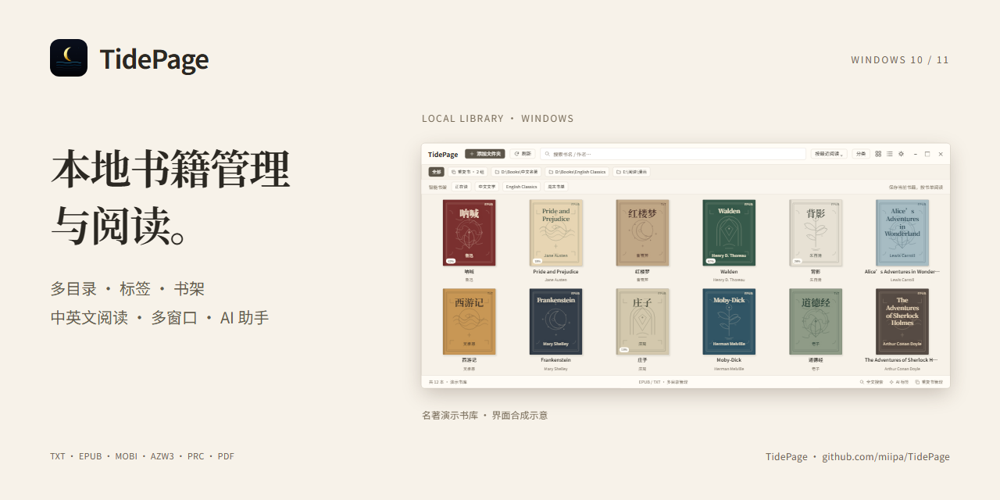
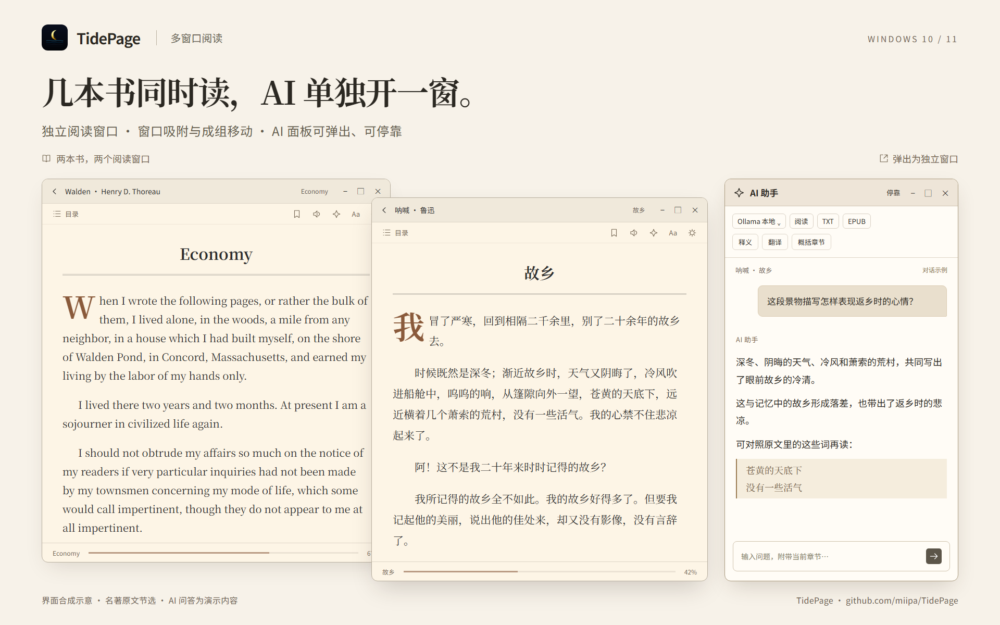
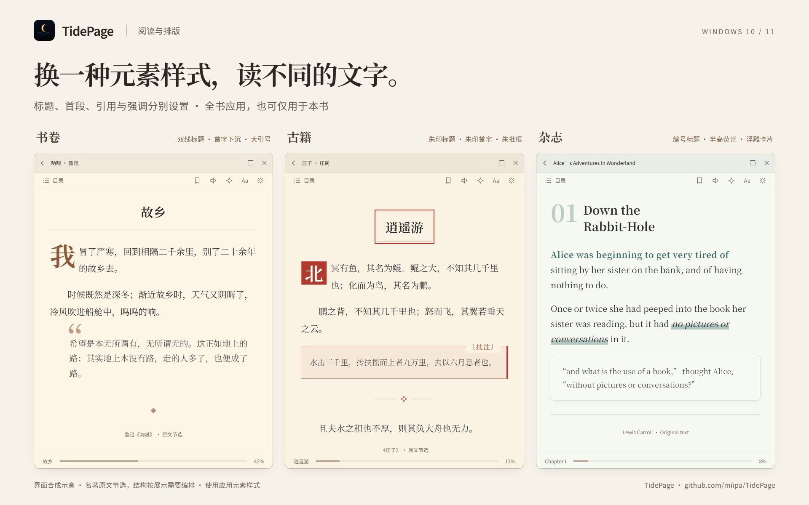
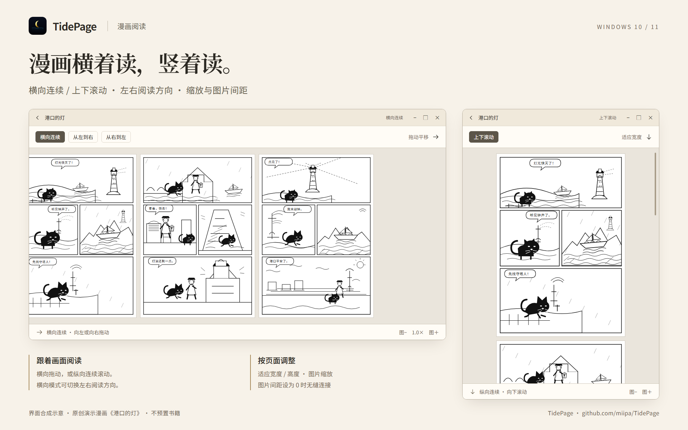

<div align="center">

# TidePage

**本地书籍管理与阅读工具**

Windows 10 / 11 · TXT · EPUB · MOBI · AZW3 · PRC · PDF

[下载最新版](https://github.com/miipa/TidePage/releases/latest) · [本地书库](#本地书库) · [多窗口与 AI](#多窗口与-ai) · [English](README.en.md)



</div>

## 本地书库

TidePage 用于整理和阅读电脑里的电子书。添加本地文件夹后，散落在不同目录的书籍可以在同一书库中查看。导入时保留原文件的位置，阅读进度、书签、划线和笔记保存在本机。

| 管理书籍 | 使用方式 |
| --- | --- |
| 多目录管理 | 添加多个文件夹，查看扫描进度，刷新目录中的新增和移除项 |
| 标签与书架 | 按标签分类，把选中的书或当前筛选结果保存为书架 |
| 搜索与排序 | 搜索书名、作者，按格式、目录、阅读状态和标签筛选；全文索引可查找正文与章节 |
| 重复书管理 | 集中查看重复书籍及其所在目录，选择保留的副本 |
| 详情与批量操作 | 编辑书名、作者，打开文件所在目录，批量添加标签或移出书库 |

书库提供网格和列表视图，可按最近阅读、添加时间、书名、文件时间或文件大小排序。仅移出书库会保留本地文件；删除本地文件会将其移入回收站。书籍详情中的「保存信息」只修改应用内记录，EPUB 另可选择「保存到书籍」写回原文件。

## 多窗口与 AI

开启多窗口选项后，主窗口保留在书库，双击不同的书即可分别阅读。阅读窗口支持吸附和成组移动，适合同时翻阅原文、译本或参考书。

AI 助手可以放在阅读侧栏，也可以弹出为独立窗口，再停靠回来。提问可附带当前书名与章节节选；选中文本可翻译或释义，结果可以加入划线笔记。支持本地 Ollama 和在线模型服务，使用前需自行配置。



## 阅读与排版

正文支持上下滚动、单栏翻页和双栏翻页。五套阅读主题之外，还能调整字体、字号、行高、段距、缩进、对齐和背景，并为不同书籍保留单独的设置。

元素样式用于调整标题、首段、引用、列表、插图、表格和强调等内容的呈现。内置书卷、古籍、杂志、手账、学术等方案，也可逐项选择样式或添加自定义 CSS。下图用《故乡》《庄子》和 Alice’s Adventures in Wonderland 的不同段落，展示双线标题、首字下沉、朱印、引用框和荧光强调。



## 漫画阅读

图片型电子书可切换到漫画模式，支持自动识别与手动切换。上下滚动时，页面纵向连续排列；横向连续模式可拖动平移，并选择从左到右或从右到左阅读。

图片可适应宽度或高度，也可调整缩放与间距；间距设为 0 时无缝连接。支持隐藏全部图片、单独屏蔽页面和恢复显示。



## 更多阅读工具

| 功能 | 内容 |
| --- | --- |
| 书签与笔记 | 目录、书内搜索、七种划线样式、按书汇总笔记与阅读统计 |
| 语音朗读 | 系统语音或在线语音，支持高亮跟随、自动续读和定时停止 |
| 格式转换 | TXT ⇄ EPUB；MOBI / AZW3 / PRC → TXT 或 EPUB，另存为新文件 |
| WebDAV | 同步阅读进度、上传或下载书籍、备份和恢复设置 |

## 支持格式

| 类型 | 支持 |
| --- | --- |
| 电子书 | TXT、EPUB、MOBI、AZW3、PRC、PDF |
| 文本编码 | 自动识别 UTF-8、UTF-16、GB18030、Big5 等；支持手动指定 |

## 文件、数据与联网

原书从已添加的本地目录读取。书库记录、阅读数据、配置和缓存默认保存在系统应用数据目录，可用 `TIDEPAGE_DATA_DIR` 指定其他位置。设置中可查看缓存用量并清理缓存。

使用 AI 对话、划词或 AI 标签时，相关书目信息与文本会发送到所配置的模型服务；Ollama 请求也发往配置的服务地址。在线朗读连接所选语音服务，WebDAV 按同步操作传输书籍与阅读数据。应用启动时会查询 GitHub Releases 检查更新，设置中也可手动检查。

## 下载与安装

1. 前往 [GitHub Releases](https://github.com/miipa/TidePage/releases/latest)，下载对应设备架构的 Windows 便携版。
2. 解压后运行 `TidePage.exe`。
3. 程序需要 WebView2 运行时；Windows 11 已内置，Windows 10 设备需确认已安装。

TidePage 目前提供 Windows 10 / 11 版本。应用数据默认保存在系统应用数据目录，更新程序文件时可保留原有书库与阅读记录。

## 本地开发

需要 [Node.js](https://nodejs.org/) 与 [Rust](https://www.rust-lang.org/) 工具链。

```bash
npm install
npm run tauri dev
npm run check
npm run test
npm run check:name
```

技术栈：Tauri 2、Rust、SvelteKit、Svelte 5、TypeScript 与 SQLite。

配图为基于当前功能制作的界面合成示意。书库选用中英文名著作为演示书目，封面自绘；阅读图节选鲁迅《故乡》、古籍《庄子》、Walden 与 Alice’s Adventures in Wonderland 原文，结构按展示需要编排。漫画《港口的灯》为原创，AI 问答为演示内容；应用不预置这些图书。

## 反馈与支持

- 问题与建议：[GitHub Issues](https://github.com/miipa/TidePage/issues)
- 项目主页：<https://github.com/miipa/TidePage>
- QQ 交流群：<https://qm.qq.com/q/5bbjW2NIUU>

## 许可

[MIT](LICENSE)
