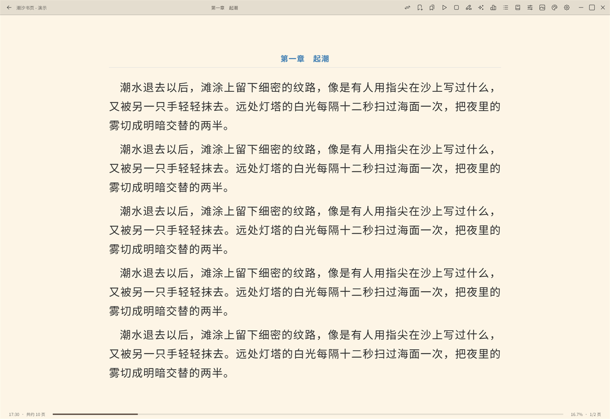
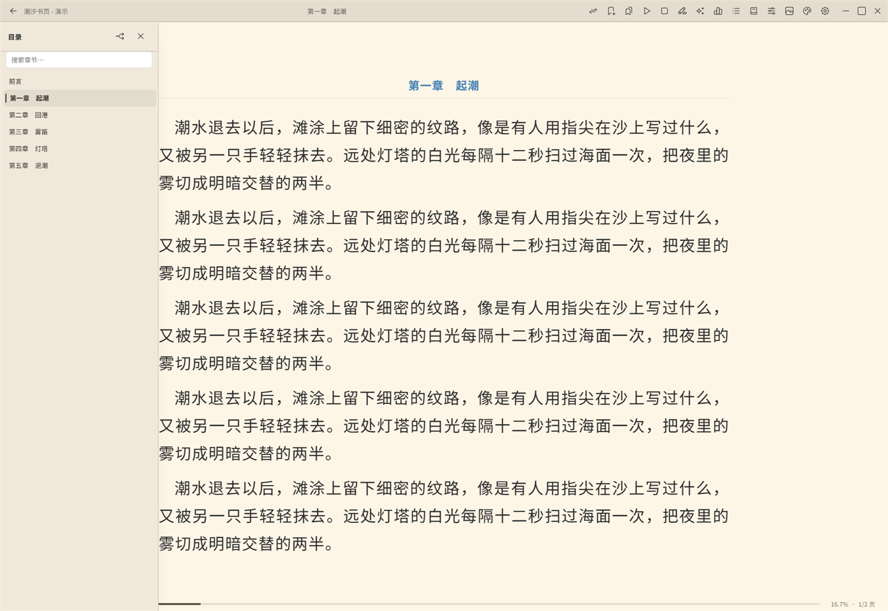
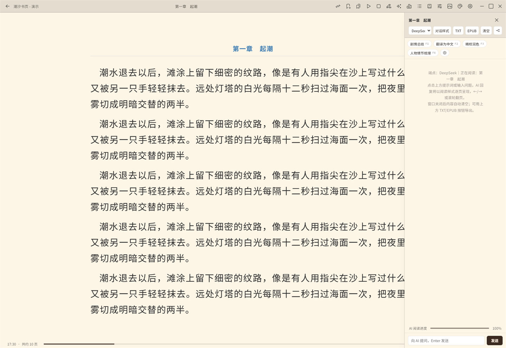
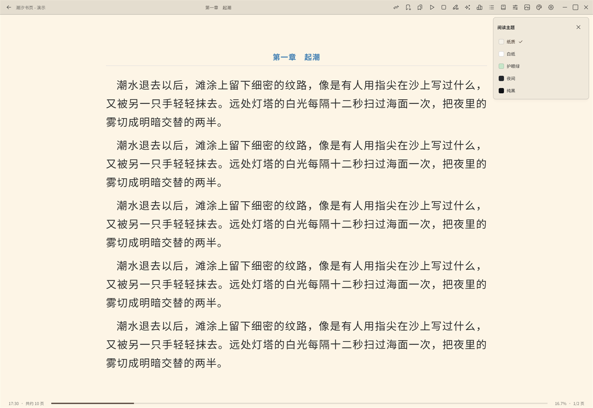
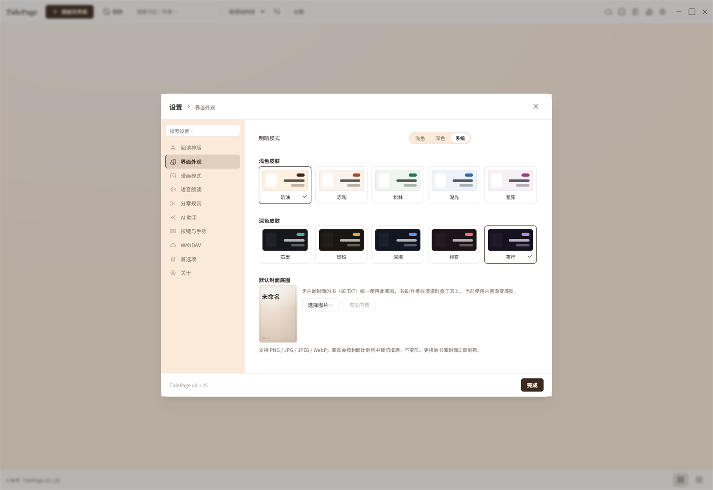
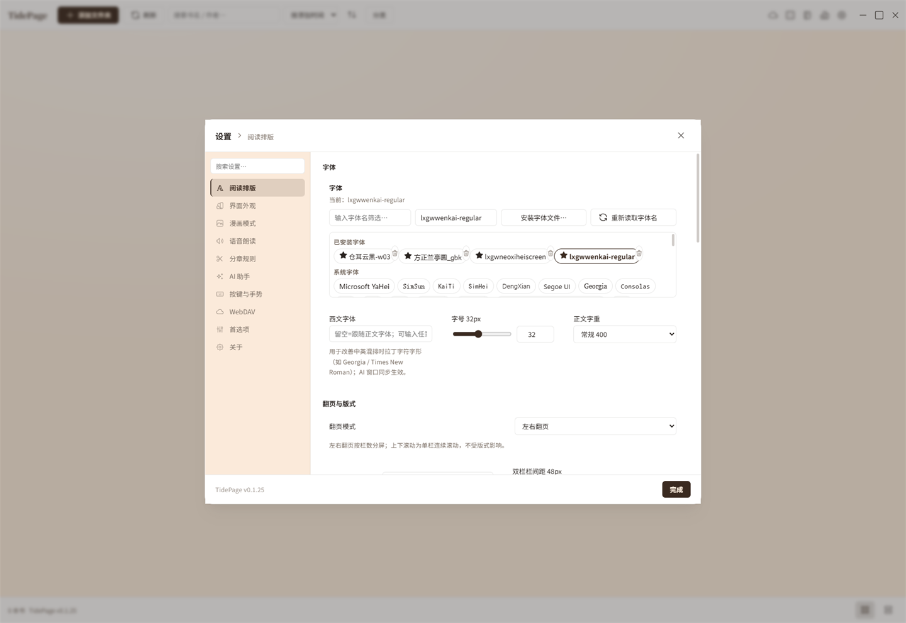
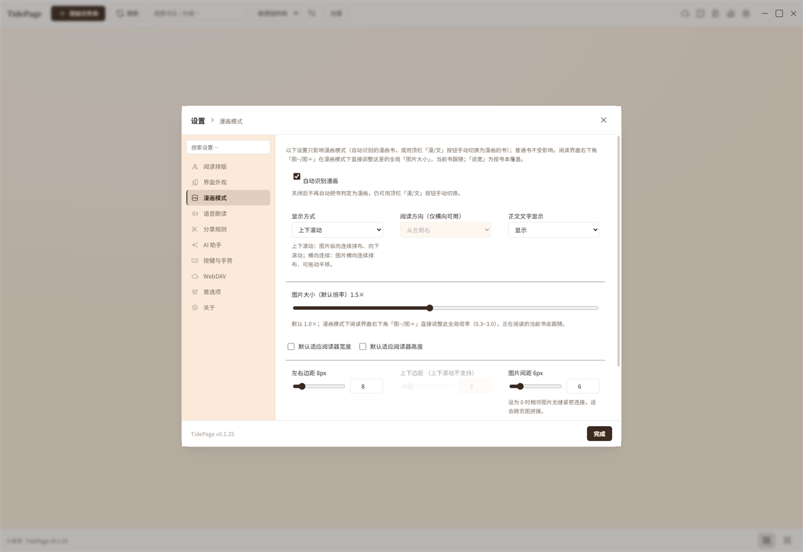
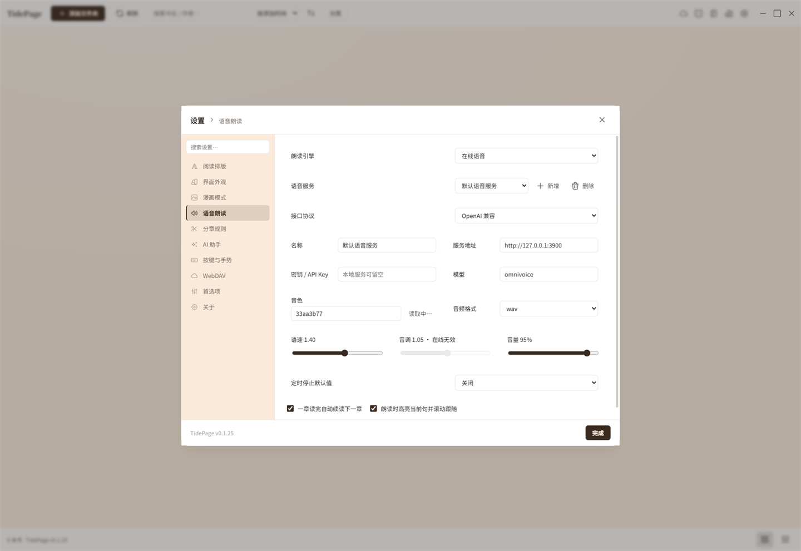
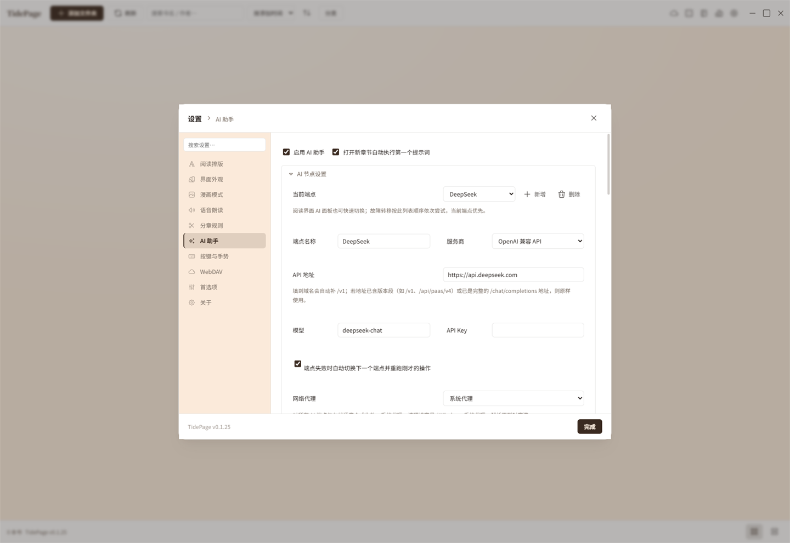
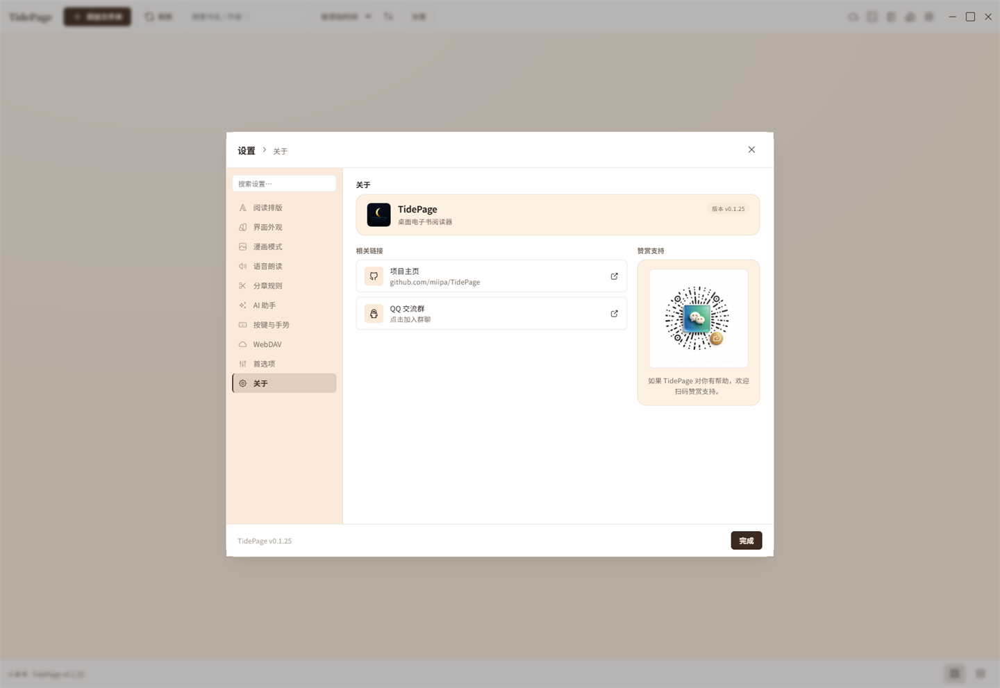

<div align="center">


# TidePage

**面向十万级本地书库的桌面电子书阅读器**

TXT · EPUB · MOBI · AZW3 · PRC　｜　舒适排版 · 漫画模式 · AI 助手 · 语音朗读

[English](README.en.md) · **简体中文**



</div>

---

## 简介

TidePage 是一款基于 **Tauri 2 + SvelteKit（Svelte 5）+ Rust** 打造的 **Windows 桌面阅读器**，专注两件事：**大书库**与**舒服地读**。

书籍、封面、进度、划线、笔记、统计全部保存在本地 SQLite 数据库里，不需要账号、不上传服务器；只有当你主动使用 AI、在线朗读或 WebDAV 时才会联网。

## 功能特性

### 书库：多目录 · 十万级

- 可登记任意多个本地书库目录，一本书也不会被搬动或改写。
- 采用虚拟滚动 + 分级寻址（rank-based paging），**面向十万级书库**设计，几十万本也能流畅滚动。
- 网格 / 列表两种视图；按最近阅读、加入时间、书名、文件时间、大小排序，支持反向。
- 按格式、阅读状态、所属文件夹筛选；按书名 / 作者搜索。
- 多选、批量删除（可删除到回收站或仅从书库移除）、随机开书、拖拽文件即入库。
- 支持把每本书在**独立新窗口**中打开。

### 阅读体验

- **阅读模式**：左右翻页、上下滚动、双栏分页。
- **章节切换**：无缝拼接或「缓冲过渡」，缓冲强度可调。
- **5 套阅读主题**（纸质 / 白纸 / 护眼绿 / 夜间 / 纯黑）+ 自定义底色 / 文字色、自定义背景图与透明度。
- **10 套界面皮肤**（奶油 / 赤陶 / 松林 / 湖光 / 紫藤 / 石墨 / 琥珀 / 深海 / 绯夜 / 夜行），明暗可分别选择。
- **配色方案**：内置 5 套、可自建并保存，支持全局应用或仅应用到本书。
- **排版**：字号、行高、段距、字重、对齐、首行缩进；左右与上下边距**按模式分别记忆**。
- **字体**：列出系统字体、可安装 TTF/OTF/TTC 自定义字体、可单独设置拉丁字体。
- 目录面板、书签、全文搜索、进度环、阅读统计（近 14 天 / 单本字数、时长、速度等）。
- **逐书覆盖**：单本的字体、缩放、是否显示图片、屏蔽指定图片、覆盖样式、漫画开关等。
- 可自定义快捷键与点击/滚轮手势（5 个点击区域 + 3 档回弹）。

### 漫画模式

- **自动识别**漫画书（按图片数量与正文稀疏度判断），也可用顶栏「漫/文」手动切换。
- **纵向连续（上下滚动）** 与 **横向连续（拖动平移翻页）** 两种显示方式。
- 阅读方向支持从左到右 / 从右到左；图片倍率、适应宽/高、上下左右边距、图片间距（0 即无缝拼接）。
- 可显示或隐藏图片、逐张屏蔽图片并随时恢复；内置图片浏览器（滚轮翻页、点击放大）。

### AI 助手

- 与**当前书 / 当前章节**对话，章节内容作为上下文注入。
- 划词**翻译 / 释义**浮窗，结果可一键加入划线笔记。
- **自定义提示词**：每个提示词可绑定 F1–F9 快捷键、拖拽排序，可设置进入新章节自动执行第一个提示词。
- 全局系统提示词、流式输出、两种展示样式（气泡对话 / 阅读器样式分页）。
- **多种服务商**：OpenAI 兼容、Ollama（本地）、Anthropic、Google Gemini、Azure OpenAI；支持**多端点故障转移**与连接测试。
- **网络代理**：自动 / 直连 / 系统代理 / 手动，支持 SOCKS；同时对 AI 与在线朗读生效。
- AI 对话可导出为 TXT / EPUB。

### 语音朗读（TTS）

- 系统语音与在线语音两种引擎；在线支持 OpenAI 兼容、Azure、DashScope、MiniMax、Fish Audio、GPT-SoVITS、Breeze、火山（豆包）、百度、Edge TTS 等。
- 语速 / 音调 / 音量、定时停止、**朗读高亮并滚动跟随当前句**、读完自动续读下一章。

### 划线与笔记

- 7 种划线样式（下划线 / 波浪 / 点线 / 双线 / 背景色 / 删除线 / 方框）与自定义颜色。
- 笔记按书汇总、可搜索、可跳转；删除书籍后划线仍可保留。

### 备份与同步

- **WebDAV**：阅读进度同步、上传 / 下载书籍、浏览远端目录、远端设置备份与恢复。
- 设置项支持剪贴板复制 / 导入；导出配置时可自动剔除密钥。
- **本地凭据（AI / TTS / WebDAV 密钥）使用 Windows DPAPI 按当前用户加密**，密文落盘、明文不写入本地存储。

### 其他

- 全文索引（SQLite FTS5）支持**全库检索**，可一键重建索引。
- 书籍详情查看 / 编辑（书名、作者，可回写 EPUB）、在资源管理器中定位、阅读历史。
- 存储空间用量查看与缓存清理；系统托盘、窗口状态记忆、沉浸模式。
- 界面语言：简体中文 / English（即时切换）。

## 支持格式

- **电子书**：TXT、EPUB、MOBI、AZW3、PRC
- **文本编码**：自动识别（UTF-8 / UTF-16 / GB18030 / Big5 等），也可手动指定
- **漫画 / 封面图片**：PNG、JPG/JPEG、GIF、BMP、WebP

> 说明：暂不支持 PDF 与 CBZ/CBR 压缩包；漫画内容来自 EPUB / MOBI 的图片页。

## 截图

### 阅读 · 目录 · 主题

<p>


</p>
<p>


</p>

### 设置面板

<p>


</p>
<p>


</p>
<p>


</p>

## 技术栈

- **Tauri 2** + Rust（`rusqlite` / `reqwest` / `image` / `zip` / `quick-xml` / `mobi` 等）
- **SvelteKit 2** + **Svelte 5（runes）** + TypeScript + Vite
- 本地存储：SQLite（WAL）；凭据加密：Windows DPAPI
- 原生 CSS 设计令牌体系，无 Tailwind / 无预处理器

## 运行与构建

需要 [Node.js](https://nodejs.org/) 与 [Rust](https://www.rust-lang.org/) 工具链。

```bash
npm install

npm run tauri dev        # 开发调试
npm run release          # 打包安装包 + exe
npm run release:exe      # 只产出 exe，便于快速验证
```

> 发布桌面版请务必使用 Tauri CLI（`npm run release`）。裸 `cargo build --release` 不会构建并嵌入前端资源，产出的程序会指向开发地址而无法运行。

## 系统要求

- **Windows 10 / 11（x64）**
- WebView2 运行时（Windows 11 已内置；Windows 10 可能需要单独安装）
- 凭据加密依赖 Windows DPAPI，因此当前仅发布 Windows 版本

## 反馈与支持

- 项目主页 / 问题反馈：<https://github.com/miipa/TidePage>
- QQ 交流群：<https://qm.qq.com/q/5bbjW2NIUU>
- 如果 TidePage 对你有帮助，欢迎在软件「设置 → 关于」中扫码赞赏支持。

## 许可

[MIT](LICENSE)
